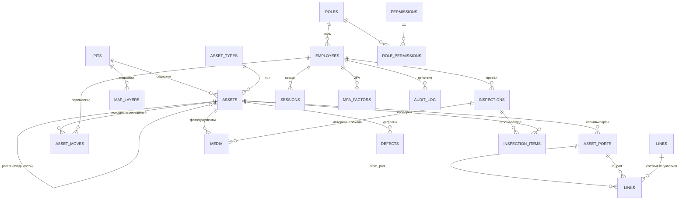

# Модель данных «Карьер: электроснабжение и оборудование»

Версия: 2.0 (проект) · Статус: **на согласование** · СУБД: PostgreSQL 16+

---

## 0. Принципы и соглашения

1. **Один объект — одна строка.** Любой объект схемы (подстанция, КТП, разъединитель, «кукушка», мачта, ячейка) — запись в `gis.assets` с типом из справочника. Это позволяет строить граф без зоопарка таблиц и добавлять новые типы оборудования без миграции схемы БД.
2. **Связь — отдельная сущность.** Линия/кабель/перемычка — запись в `gis.links` между **портами** объектов, а не поле `fromId/toId` на объекте. Только так можно описать: разъединитель «в разрыв» линии, КТП с одним вводом и четырьмя отходящими, резервный ввод, транзит через РП.
3. **Топология и геометрия разделены.** `links` знает «что с чем соединено», `links.geometry` — «как это нарисовано на карте». Одно без другого не ломает второе.
4. **Координаты — в метрах местной системы координат карьера**, а не в пикселях картинки. Растровая схема — это подложка с привязкой (`map_layers`). Замена подложки не сдвигает объекты.
5. **Ничего не удаляется физически.** `deleted_at` + `deleted_by`. Удаление — это операция с журналом, а не `DELETE`.
6. **Каждое изменение — событие.** `ops.change_log` (лента изменений для синхронизации) + `audit.audit_log` (кто, что, откуда, с какого устройства).
7. **Оптимистическая блокировка.** Колонка `version int` на изменяемых сущностях; конфликт версий разрешается явно, а не «кто последний, тот и прав» по умолчанию.
8. **Идентификаторы — UUID v7** (время-упорядоченные, генерируются приложением) для всех бизнес-сущностей; `bigserial` — только для журналов/лент.
9. Имена: `snake_case`, таблицы во множественном числе, перечисления — `text` + `CHECK` (проще расширять, чем `ENUM`), деньги/мощности — `numeric`.

Схемы БД (PostgreSQL schemas): `auth`, `gis`, `ops`, `audit`.

---

## 1. ER-диаграмма (верхний уровень)

Полная детализация — ниже, по доменам.

---

## 2. Домен `auth` — сотрудники, доступ, 2FA

### 2.1 `auth.employees` — сотрудник (он же «разрешённый табельный номер»)

| Колонка | Тип | Примечание |
|---|---|---|
| `id` | uuid PK | UUID v7 |
| `tab_no` | text UNIQUE NOT NULL | табельный номер, **логин**; нормализованный (trim, upper, без пробелов) |
| `full_name` | text NOT NULL | ФИО |
| `position` | text | должность |
| `department` | text | участок/цех |
| `phone_e164` | text | для OTP/резерва 2FA, формат +7… |
| `email` | citext | для OTP/уведомлений |
| `telegram_id` | bigint | привязка Telegram-бота |
| `role_id` | uuid FK → `roles` | администратор / оператор / наблюдатель |
| `status` | text CHECK (`active`,`blocked`,`dismissed`) | `dismissed` блокирует вход навсегда |
| `access_until` | date | для подрядчиков/временных |
| `hired_at`, `dismissed_at` | date | |
| `created_by`, `created_at`, `updated_at` | | кто завёл карточку |
| `version` | int | |

Инварианты:
* создать сотрудника может только администратор (или импорт из 1С);
* `tab_no` **не переиспользуется** после увольнения — на это нужно ваше подтверждение (см. вопрос Q-3);
* `tab_no` — персональные данные, в ответах API маскируется для не-админов.

### 2.2 `auth.credentials`

| Колонка | Тип | Примечание |
|---|---|---|
| `employee_id` | uuid PK FK | 1:1 |
| `password_hash` | text | **Argon2id** (memory 64 МБ, t=2, p=1) |
| `password_algo` | text | `argon2id` |
| `password_updated_at` | timestamptz | |
| `must_change` | bool | после сброса админом |
| `failed_attempts` | smallint | счётчик подряд идущих неудач |
| `locked_until` | timestamptz | экспоненциальная блокировка: 5 попыток → 1 мин, 10 → 15 мин, 15 → обращение к админу |
| `last_login_at` | timestamptz | |

Пароль хранится **только** здесь; в `employees` пароля нет.

### 2.3 `auth.mfa_factors`

| Колонка | Тип | Примечание |
|---|---|---|
| `id` | uuid PK | |
| `employee_id` | uuid FK | |
| `kind` | text CHECK (`totp`,`webauthn`,`telegram`,`sms`) | |
| `label` | text | «Телефон Pixel 7» |
| `secret_enc` | bytea | TOTP-секрет, зашифрован AES-256-GCM ключом приложения (KMS/ENV) |
| `public_key` / `credential_id` | bytea / text | для WebAuthn |
| `confirmed_at` | timestamptz | до подтверждения фактор не активен |
| `last_used_at`, `last_counter` | | защита от повторного использования TOTP-кода |
| `revoked_at` | timestamptz | |

### 2.4 `auth.recovery_codes`

`id`, `employee_id`, `code_hash` (Argon2id), `used_at`, `created_at`. 10 одноразовых кодов, показываются один раз.

### 2.5 `auth.sessions`

| Колонка | Тип | Примечание |
|---|---|---|
| `id` | uuid PK | = `sid` в токене |
| `employee_id` | uuid FK | |
| `device_id` | uuid FK → `devices` | |
| `family_id` | uuid | цепочка ротаций refresh-токена |
| `refresh_hash` | text | хэш текущего refresh-токена |
| `created_at`, `expires_at`, `revoked_at`, `revoke_reason` | | |
| `last_seen_at`, `ip`, `user_agent` | | |

Правила: refresh-токен в `httpOnly; Secure; SameSite=Strict` cookie, ротация при каждом обновлении, повторное использование старого токена → отзыв всей `family_id` (детект кражи). Одновременно допускается N сессий на сотрудника (для офлайн-смены — увеличить TTL refresh до 30 суток, см. НФТ-офлайн).

### 2.6 `auth.devices`

`id`, `employee_id`, `name`, `platform` (`android`,`ios`,`web`), `app_version`, `push_token`, `first_seen_at`, `last_sync_at`, `revoked_at`.

### 2.7 `auth.onboarding_tokens` (закрытая регистрация)

| Колонка | Тип | Примечание |
|---|---|---|
| `id` | uuid PK | |
| `employee_id` | uuid FK | табельный уже заведён админом |
| `channel` | text (`telegram`,`email`,`sms`,`manual`) | куда ушёл код |
| `code_hash` | text | 6 цифр, Argon2id, TTL 10 мин |
| `attempts` | smallint | максимум 5 |
| `expires_at`, `consumed_at` | | |

Логика: `tab_no` → есть карточка и `status='active'` и нет `credentials` → отправляем код на **заранее внесённый** контакт → код верный → пользователь задаёт пароль и enrolling TOTP. Посторонний, зная чужой табельный, всё равно не получит код.

### 2.8 `auth.roles`, `auth.permissions`, `auth.role_permissions`

`roles`: `admin` (инженер/диспетчер), `operator` (рабочий/обходчик), `viewer` (наблюдатель, read-only), `contractor` (опционально — ограниченный по объектам).

`permissions` (коды): `topology.edit`, `asset.create`, `asset.delete`, `asset.status.edit`, `asset.move`, `media.create`, `inspection.create`, `defect.manage`, `employee.manage`, `audit.view`, `report.export`, `settings.edit`.

Матрица прав — в ТЗ (раздел 3). Проверка прав — на API (dependency) и дополнительно в БД через RLS (defense in depth, см. ТЗ §8).

---

## 3. Домен `gis` — карьер, объекты, топология

### 3.1 `gis.pits` — карьер

`id`, `code`, `name`, `timezone` (`Asia/Irkutsk`), `crs_name` (напр. «МСК-38, зона 1» или «локальная СК карьера»), `units` (`m`), `created_at`, `is_active`.
На будущее: несколько карьеров в одной инсталляции — `pit_id` есть во всех таблицах.

### 3.2 `gis.map_layers` — подложка карты

| Колонка | Тип | Примечание |
|---|---|---|
| `id` | uuid PK | |
| `pit_id` | uuid FK | |
| `name` | text | «Схема горных работ 2026-01», «Космоснимок» |
| `kind` | text (`raster`,`cad`,`tiles`) | |
| `blob_url`, `blob_path` | text | Vercel Blob |
| `width_px`, `height_px` | int | |
| `origin_x`, `origin_y` | numeric | координаты левого-нижнего угла в метрах СК карьера |
| `pixel_size_x`, `pixel_size_y` | numeric | метров на пиксель |
| `rotation_deg` | numeric | если скан повёрнут |
| `min_zoom`, `max_zoom`, `tile_size` | int | параметры нарезки для Leaflet `CRS.Simple` |
| `version`, `is_active`, `uploaded_by`, `uploaded_at` | | |

Объекты привязаны к **метрам**, подложка — к пикселям. Меняем подложку — объекты остаются на месте. Это ключевое отличие от текущего прототипа, где всё держится на пикселях.

### 3.3 `gis.asset_types` — справочник типов

| Колонка | Тип | Примечание |
|---|---|---|
| `id` | uuid PK | |
| `code` | text UNIQUE | `substation`, `dgu`, `ktp`, `yaku`, `bku`, `ksr`, `rp`, `disconnector`, `cell`, `mast`, `pump`, `cuckoo`, `pole`, `transformer`… |
| `name` | text | «Комплектная трансформаторная подстанция» |
| `category` | text (`source`,`line`,`equipment`,`mobile`,`lighting`,`aux`,`pole`) | влияет на иконку, фильтры и правила графа |
| `icon`, `color` | text | для карты и легенды |
| `attr_schema` | jsonb | JSON-Schema доп. атрибутов типа (валидируется на API) |
| `allowed_parent_types` | text[] | что в что можно вкладывать (ячейка → БКРУ/КСР) |
| `port_template` | jsonb | шаблон создания портов («1 ввод + 4 отходящих») |
| `is_mobile_default` | bool | |
| `sort_order` | int | |

Справочник **редактируемый админом** (добавить тип без релиза) — но с валидацией и записью в аудит.

### 3.4 `gis.assets` — объект (узел графа)

| Колонка | Тип | Примечание |
|---|---|---|
| `id` | uuid PK | |
| `pit_id` | uuid FK | |
| `asset_type_id` | uuid FK | |
| `code` | text | инвентарный/диспетчерский номер, «КТП-14», «ф.21К» |
| `name` | text NOT NULL | |
| `parent_asset_id` | uuid FK → assets | входимость: ячейка в БКРУ, БКРУ в РП |
| `zone_id` | uuid FK → `zones` | горизонт/борт/отвал (для фильтров и отчётов) |
| `status` | text CHECK (`on`,`off`,`standby`,`maintenance`,`decommissioned`) | **эксплуатационное** состояние: включено/отключено/резерв/ремонт/списано |
| `lifecycle` | text CHECK (`planned`,`installed`,`reserve`,`written_off`) | учётное состояние |
| `grounded` | bool | установлено заземление |
| `grounded_at`, `grounded_by` | | |
| `is_mobile` | bool | «кукушка», передвижной ДГУ, насос |
| `x`, `y`, `z` | numeric | метры СК карьера (z — отметка, опционально) |
| `lat`, `lon` | double precision | WGS84, только если объект реально геопривязан |
| `location_text` | text | «гор. +120, борт северный» — как в текущем прототипе |
| `attrs` | jsonb | тип-специфичные поля: `power_kva`, `voltage_kv`, `model`, `serial_no`, `rlnd_no`, `cable_mark`, `fuel_capacity_l`, `manufacturer`, `commissioned_at`… |
| `photo_cover_id` | uuid FK → media | превью для карточки/списка |
| `created_by/at`, `updated_by/at` | | |
| `version` | int | оптимистическая блокировка |
| `deleted_at`, `deleted_by` | | soft delete |

Индексы: `(pit_id, asset_type_id)`, `(parent_asset_id)`, `(code)` — частичный уникальный `WHERE deleted_at IS NULL` в рамках `pit_id`, `attrs` — GIN при необходимости.

Почему `attrs` в JSONB, а не 40 колонок: типов много, они разные, и справочник типов расширяемый. Валидация — по `asset_types.attr_schema` (Pydantic-модель, дискриминированная по `code`), поэтому «мусор» в jsonb не попадёт. Ключевые поля вынесены в колонки, потому что по ним ищут и фильтруют (`status`, `is_mobile`, координаты, `code`).

### 3.5 `gis.asset_ports` — порты (клеммы) объекта

| Колонка | Тип | Примечание |
|---|---|---|
| `id` | uuid PK | |
| `asset_id` | uuid FK | |
| `code` | text | `IN-1`, `OUT-1`, `A`, `B` |
| `name` | text | «Ввод №1», «Отходящая №3» |
| `kind` | text CHECK (`in`,`out`,`io`) | `io` — двунаправленный (разъединитель, шина) |
| `nominal_voltage_kv` | numeric | 35 / 6 / 0.4 |
| `phase` | text | `3ph`, `L1`… |
| `sort_order` | int | порядок в однолинейной схеме |

Порт — это «точка подключения». Без портов не описать разъединитель «в разрыв» и КТП «1 ввод / 4 вывода».

### 3.6 `gis.lines` — линия/фидер (логическая)

| Колонка | Тип | Примечание |
|---|---|---|
| `id` | uuid PK | |
| `pit_id` | uuid FK | |
| `code` | text | «ф.21К», «ВЛ-6 кВ №4» |
| `name` | text | |
| `kind` | text CHECK (`overhead`,`cable`,`busbar`) | ВЛ / КЛ / шина |
| `voltage_kv` | numeric | |
| `source_asset_id` | uuid FK | откуда выходит (ПС/БКРУ) |
| `conductor_mark` | text | «АС-70», «СБ-3×95» |
| `length_m` | numeric | расчётная |
| `state` | text CHECK (`energized`,`deenergized`,`grounded`) | оперативное состояние линии |
| `status` | text | `in_service`, `reserve`, `repair` |
| `deleted_at` | | |

`lines` — это «электрическая линия» из вашего ТЗ-описания. Одна линия может быть нарисована несколькими участками (`links`), проходить через разъединитель и заканчиваться на КТП.

### 3.7 `gis.links` — участок связи (ребро графа + геометрия)

| Колонка | Тип | Примечание |
|---|---|---|
| `id` | uuid PK | |
| `pit_id` | uuid FK | |
| `from_port_id` | uuid FK | |
| `to_port_id` | uuid FK | |
| `line_id` | uuid FK NULL | принадлежность к логической линии |
| `link_type` | text CHECK (`cable`,`overhead`,`busbar`,`jumper`,`internal`) | `internal` — связь внутри объекта (ввод→шины) |
| `feed_role` | text CHECK (`main`,`reserve`,`backup`) | основной/резервный/аварийный ввод |
| `state` | text CHECK (`connected`,`open`,`grounded`) | положение коммутационного аппарата **на этом участке** |
| `geometry` | jsonb | `[[x,y],[x,y],…]` — полилиния в метрах СК |
| `length_m` | numeric | из геометрии или введено вручную |
| `cable_mark`, `cross_section_mm2`, `cores` | | марка/сечение/жильность |
| `install_year` | int | |
| `attrs` | jsonb | прочее |
| `created_by/at`, `updated_by/at`, `version`, `deleted_at` | | |

Ограничения:
* `from_port_id <> to_port_id`;
* порты принадлежат **разным** объектам (кроме `internal`);
* `CHECK` на согласованность напряжения портов (кроме связей через трансформатор — там `internal`);
* запрет второго активного `main`-ввода на один потребительский порт (частичный уникальный индекс `WHERE state='connected' AND feed_role='main' AND deleted_at IS NULL` по `to_port_id`).

### 3.8 `gis.asset_moves` — история перемещений мобильных объектов

| Колонка | Тип | Примечание |
|---|---|---|
| `id` | uuid PK | |
| `asset_id` | uuid FK | |
| `from_x/from_y`, `to_x/to_y` | numeric | |
| `from_lat/from_lon`, `to_lat/to_lon` | double precision | GPS-точка устройства |
| `accuracy_m` | numeric | точность GPS |
| `moved_at` | timestamptz | **время события по часам устройства** (`captured_at`) |
| `received_at` | timestamptz | когда дошло до сервера |
| `moved_by` | uuid FK → employees | |
| `device_id` | uuid | |
| `note` | text | «переставили на горизонт +90» |
| `media_id` | uuid FK | фото на новом месте |
| `source` | text (`online`,`offline`) | |
| `conflict` | bool | есть конкурирующее перемещение в окне |

История **только дописывается**. Текущее положение дублируется в `assets.x/y` и `assets.position_updated_at` для быстрых выборок.

### 3.9 `gis.switching_ops` — журнал переключений

`id`, `pit_id`, `target_kind` (`asset`|`link`), `target_id`, `action` (`close`,`open`,`ground_on`,`ground_off`), `from_state`, `to_state`, `performed_by`, `performed_at`, `captured_at`, `device_id`, `reason`, `permit_no` (наряд-допуск), `approved_by`, `note`, `media_id`.

Зачем отдельно от `change_log`: это юридически значимый оперативный журнал, по которому восстанавливают хронологию аварии; формат и срок хранения — по правилам эксплуатирующей организации (см. вопрос Q-9).

### 3.10 `gis.topology_snapshots` — версии схемы

`id`, `pit_id`, `number`, `created_at`, `created_by`, `comment`, `payload` (jsonb: снимок `assets`+`links` на момент публикации), `diff` (jsonb: что изменилось относительно предыдущей).
Нужно для: «покажи схему на дату аварии», «откатить ошибочную правку», «сравнить проектный и фактический».

### 3.11 `gis.zones` — участки/горизонты

`id`, `pit_id`, `name`, `kind` (`horizon`,`side`,`dump`,`road`,`facility`), `geometry` jsonb (полигон, опционально). Для фильтров, отчётов и маршрутов обхода.

---

## 4. Домен `ops` — обходы, дефекты, фото, измерения

### 4.1 `ops.inspections` — обход/осмотр

| Колонка | Тип | Примечание |
|---|---|---|
| `id` | uuid PK | |
| `pit_id` | uuid FK | |
| `kind` | text (`walk`,`targeted`,`emergency`,`acceptance`) | плановый обход / точечный / аварийный / приёмка |
| `route_id` | uuid FK NULL | если по маршруту |
| `employee_id` | uuid FK | |
| `started_at`, `finished_at` | timestamptz | |
| `status` | text (`draft`,`in_progress`,`submitted`,`accepted`,`rejected`) | |
| `gps_track` | jsonb | трек устройства (опционально) |
| `note` | text | |
| `device_id`, `sync_state` | | |

### 4.2 `ops.inspection_items` — что проверено

`id`, `inspection_id`, `asset_id`, `result` (`ok`,`defect`,`critical`,`not_found`,`no_access`), `comment`, `checked_at`, `x`,`y`, `media_ids` (или через `media.inspection_item_id`).

### 4.3 `ops.defects`

`id`, `pit_id`, `asset_id`, `inspection_id`, `severity` (`low`,`medium`,`high`,`critical`), `category` (`electrical`,`mechanical`,`grounding`,`fire`,`other`), `description`, `status` (`open`,`in_progress`,`fixed`,`accepted`,`rejected`), `detected_at`, `detected_by`, `assigned_to`, `due_at`, `fixed_at`, `fixed_by`, `closed_at`, `media_id`.

### 4.4 `ops.media` — фото/видео/документы (главная таблица фотофиксации)

| Колонка | Тип | Примечание |
|---|---|---|
| `id` | uuid PK | |
| `pit_id` | uuid FK | |
| `asset_id` | uuid FK NULL | объект |
| `inspection_id` | uuid FK NULL | обход |
| `inspection_item_id` | uuid FK NULL | конкретная строка обхода |
| `defect_id` | uuid FK NULL | дефект |
| `move_id` | uuid FK NULL | перемещение «кукушки» |
| `kind` | text (`photo`,`video`,`document`,`panorama`) | |
| `purpose` | text (`inspection`,`defect`,`install`,`move_proof`,`passport`,`other`) | |
| `blob_path` | text | путь в Vercel Blob |
| `blob_url` | text | публичный/подписанный URL |
| `thumb_url` | text | превью 512 px |
| `mime`, `size_bytes`, `width`, `height` | | |
| `sha256` | text | дедупликация, доказательство целостности |
| `captured_at` | timestamptz | **время съёмки по EXIF/часам устройства** |
| `received_at` | timestamptz | время приёма сервером |
| `lat`, `lon`, `accuracy_m` | | геометка (EXIF → GPS устройства → позиция объекта) |
| `geo_source` | text CHECK (`exif`,`device`,`asset`,`manual`) | откуда взялись координаты |
| `author_id` | uuid FK | |
| `author_tab_no` | text | **снимок** табельного на момент съёмки |
| `author_name` | text | **снимок** ФИО на момент съёмки |
| `watermark_applied` | bool | «сожжены» ли дата/автор/координаты в изображение |
| `exif` | jsonb | исходный EXIF (кроме GPS-мусора при необходимости) |
| `sync_state` | text (`pending`,`uploading`,`ready`,`failed`) | |
| `deleted_at` | | |

Снимки `author_tab_no`/`author_name` — осознанно денормализованы: отчёт должен показывать, кто был автором **тогда**, даже если сотрудник уволился или сменил фамилию.

### 4.5 `ops.measurements` — измерения/нагрузки (задел под графики)

`id`, `asset_id`, `metric` (`power_kw`,`current_a`,`voltage_v`,`fuel_level_pct`,`temperature_c`,`energy_kwh`), `value` numeric, `unit`, `measured_at`, `source` (`manual`,`device`,`import`), `recorded_by`, `note`.
Партиционирование по месяцам, агрегаты — materialized view `ops.measurements_hourly`. В MVP — ручной ввод показаний; промышленный учёт (АСКУЭ) — отдельный этап.

### 4.6 `ops.sync_batches`, `ops.conflicts` — офлайн-синхронизация

`sync_batches`: `id` (uuid = `batch_id` идемпотентности), `device_id`, `employee_id`, `received_at`, `ops_count`, `applied_count`, `rejected_count`, `client_version`.

`conflicts`: `id`, `entity`, `entity_id`, `kind` (`move_race`,`status_race`,`delete_vs_update`,`version_mismatch`,`duplicate_code`), `incoming` jsonb, `current` jsonb, `resolution` (`auto_lww`,`auto_merged`,`needs_review`,`manual`), `resolved_by`, `resolved_at`, `note`.

### 4.7 `ops.change_log` — лента изменений (для pull-синхронизации и аудита)

| Колонка | Тип | Примечание |
|---|---|---|
| `seq` | bigint IDENTITY PK | монотонный курсор |
| `entity` | text | `asset`, `link`, `media`, `defect`… |
| `entity_id` | uuid | |
| `op` | text (`insert`,`update`,`delete`,`restore`) | |
| `payload` | jsonb | после (или дельта) |
| `actor_id`, `device_id` | | |
| `client_ts`, `server_ts` | timestamptz | |
| `pit_id` | uuid | фильтр по карьеру |

Клиент делает `GET /sync/pull?since=<seq>` и получает дельту; `seq` — единый курсор, «часовые стрелки» устройств не важны.

---

## 5. Домен `audit`

### 5.1 `audit.audit_log` (append-only, партиционирование по месяцам)

`id` bigserial, `at` timestamptz, `actor_id`, `actor_tab_no`, `actor_role`, `action` (код: `auth.login`, `asset.update`, `link.delete`, `media.upload`…), `entity`, `entity_id`, `ip`, `user_agent`, `device_id`, `request_id`, `before` jsonb, `after` jsonb, `result` (`ok`,`denied`,`error`).

Отличие от `change_log`: `change_log` — техническая лента для синхронизации (может чиститься), `audit_log` — юридический след (не чистится, только архив). Отдельный read-only пользователь БД для записи аудита — приложение не может `UPDATE`/`DELETE` эти строки.

---

## 6. Граф питания: как считается «что от чего питается»

**Направление.** Источник (`category='source'`: подстанция, ДГУ) имеет порты `out`. Потребитель — порты `in`. Коммутационные аппараты (разъединитель, ячейка, секционный выключатель) — порты `io`. Обход графа идёт от `out` к `in`, через `io` в обе стороны.

**Правила обхода** (рекурсивный CTE/итеративный обход в сервисе):
1. Стартовое множество: объекты-источники с `status='on'` и не `grounded`.
2. Переход разрешён по `link.state='connected'` и `link.deleted_at IS NULL`.
3. Через `io`-порт переходим, если сам аппарат `status='on'` (для ячейки/разъединителя это и есть «включён»).
4. `feed_role` не влияет на обход, но помечает путь как основной/резервный.
5. Если объект достижим — он «под напряжением»; в результат пишем **первый найденный путь** (для карточки: «ПС-35/6 кВ Карьер → ф.21К → БКРУ-1, яч.2 → КТП-14») и `source_asset_id`.

**Результат кэшируется**: `gis.mv_asset_energization(asset_id, energized, source_asset_id, path_asset_ids uuid[], path_link_ids uuid[], computed_at)` — materialized view, пересчитывается по триггеру «грязной» очереди (после изменения `assets.status`, `links.state`, топологии) с дебаунсом 1–2 с. Для карьера в сотни объектов это миллисекунды; полный пересчёт — страховка.

**Валидация схемы (перед публикацией изменений):**
* V1. У каждого объекта `category='equipment'` есть хотя бы один подключённый порт `in` (иначе «висящий» объект).
* V2. Нет циклов в подграфе `feed_role='main'` (кольцо допускается только через резерв с явной пометкой).
* V3. Нет двух одновременных `main`-питаний на один порт.
* V4. Напряжения на концах `link` совпадают (иначе связь обязана идти через трансформатор).
* V5. Нет ссылок на удалённые объекты/порты.
* V6. Максимальная глубина пути ≤ 32 (защита от «петель» в данных).
* V7. Суммарная мощность потребителей на фидере ≤ уставки (если заполнены `power_kva`) — предупреждение, не блокировка.

Ошибки V1–V5 — блокирующие для публикации; остальное — предупреждения с возможностью «сохранить как черновик».

---

## 7. Что денормализовано осознанно

| Поле | Где | Зачем |
|---|---|---|
| `assets.x,y` | дублирует последний `asset_moves` | карта и списки без join по истории |
| `assets.photo_cover_id` | указатель на media | список объектов с превью одним запросом |
| `links.length_m` | дублирует расчёт из geometry | ручная корректировка по факту |
| `media.author_tab_no/name` | снимок на момент съёмки | достоверность отчёта |
| `mv_asset_energization` | расчётный кэш | «под напряжением?» без обхода графа на каждый клик |
| `lines.length_m` | сумма `links.length_m` | отчёты по кабельным журналам |

---

## 8. Индексы и производительность (ориентир)

* `assets`: `(pit_id, asset_type_id) WHERE deleted_at IS NULL`, `(parent_asset_id)`, `(code)`, `(is_mobile)`, GIN по `attrs` — по необходимости.
* `links`: `(from_port_id)`, `(to_port_id)`, `(line_id)`, частичный `(to_port_id) WHERE state='connected' AND feed_role='main'`.
* `media`: `(asset_id, captured_at DESC)`, `(inspection_id)`, `(sync_state) WHERE sync_state <> 'ready'`, `(sha256)`.
* `change_log`: `seq` (PK), `(pit_id, seq)`.
* `audit_log`: `(at DESC)`, `(actor_id, at DESC)`, `(entity, entity_id, at DESC)`.
* Партиционирование по месяцам: `audit_log`, `change_log`, `media` (при >1 млн), `measurements`.
* Ожидаемый объём: 1–3 тыс. объектов, 2–5 тыс. связей, 20–50 тыс. фото/год, 100–300 тыс. событий/год. Всё это «маленькая» БД: 2 vCPU / 4 ГБ достаточно на годы.

---

## 9. Миграция из текущего прототипа (Firebase RTDB)

Текущие коллекции: `equipment`, `cables`, `reserve`, `ksr`, `lightingMasts`, `logs`, `bkru` (с вложенными `yacheykas`).

| Сейчас | Куда |
|---|---|
| `bkru` + `yacheykas[]` | `assets` (тип `bkru`, `parent=null`) + `assets` (тип `cell`, `parent=bkru`) + `asset_ports` по шаблону |
| `equipment.bkruId` / `yacheykaId` | `assets.parent_asset_id` = ячейка; связь питания — `links` от `OUT`-порта ячейки к `IN`-порту оборудования |
| `equipment.cableId/cableName` | `lines` (по имени кабеля) + `links` (участок) |
| `equipment.installedAtId/Name/Type` | `assets.parent_asset_id` (опора/мачта) + `attrs.installed_at` |
| `equipment.opora/rlnd` | `attrs.opora`, `attrs.rlnd_no` |
| `equipment.status` (`вкл`/`выкл`) | `assets.status` (`on`/`off`) |
| `cables` | `lines` + `links` |
| `reserve` | `assets` с `lifecycle='reserve'`, `status='off'` |
| `ksr` | `assets` тип `ksr` + `links` (если `cableId`) |
| `lightingMasts` | `assets` тип `mast` (`attrs.type=electric|diesel`, `attrs.fuel_level`) |
| `logs` | `audit.audit_log` (историческое, `result='legacy'`) |
| `connectionType` (`air`/`cable`) | `links.link_type` |

**Проблема миграции:** в текущих данных нет координат — `location` это строка («гор. +120»). Значит, перенос даёт нам объекты **без точек на карте**. Варианты: (а) ручная расстановка в режиме «Разложить объекты» (массовый режим: список слева, клик по карте справа), (б) импорт координат из существующего DWG/плана, если он есть, (в) привязка по текстовому описанию горизонта/борта — черновая, с последующей правкой. Нужен ответ на вопрос Q-5.

---

## 10. Вопросы по данным, без ответов на которые схема останется черновиком

1. **Q-6.** Сколько уровней напряжения реально в схеме (35/6/0,4 кВ)? Есть ли трансформация внутри КТП, которую надо показывать (ввод 6 кВ → 0,4 кВ)?
2. **Q-7.** У разъединителей нужен отдельный «третий» контакт заземления (заземляющие ножи), или достаточно флага `grounded` на объекте?
3. **Q-8.** ЯКУ/БКУ/КСР/РП в вашей терминологии — это разные типы или одно и то же в разных исполнениях? Сейчас в коде есть «БКРУ» с ячейками, а в требованиях — «БКУ» и «КСР». Нужен единый справочник (см. Q-1).
4. **Q-10.** Нужны ли паспорта оборудования и протоколы испытаний как вложения (`media.kind='document'`) — то есть версионируемые документы с датой следующей проверки?
5. **Q-12.** «Кукушки» учитываются поштучно с инвентарным номером или как тип с количеством? Нужен ли учёт топлива/моточасов?
6. **Q-15.** Есть ли интеграция с 1С по сотрудникам (табельные, ФИО, увольнения) и с чем-то по электроучёту?
